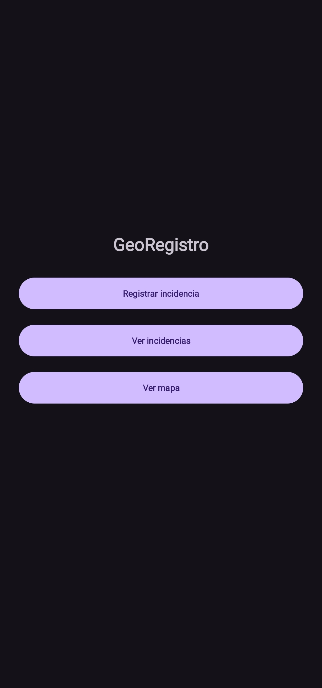
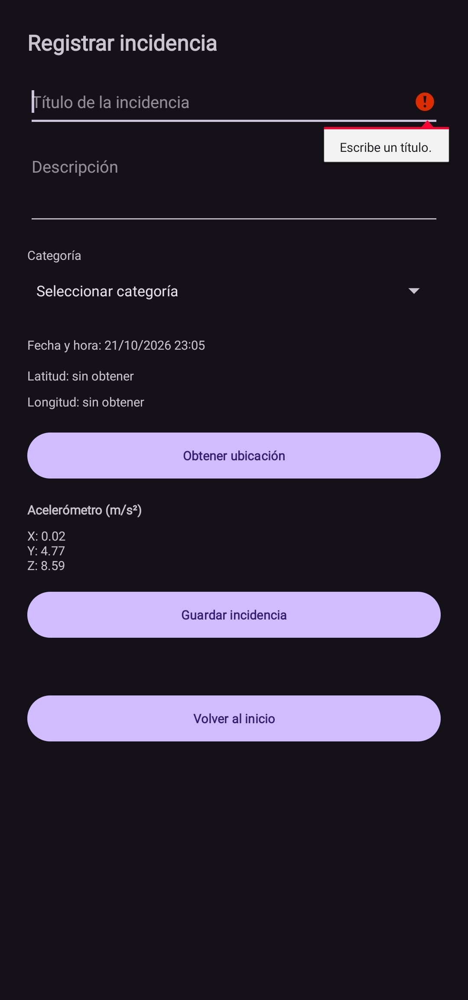

# GeoRegistro

Aplicación de Android para registrar incidencias con su ubicación y después consultarlas. Es el trabajo de Taller de Nuevas Tecnologías y está hecho con Java y pantallas XML.

La idea es simple: completar el formulario, obtener la ubicación y guardar. Desde el listado se pueden revisar las incidencias y abrir una en el mapa, cuando esté configurado.

## Funciones

- Un inicio con tres botones: registrar, ver incidencias y ver mapa.
- Un formulario con título, descripción, categoría y fecha/hora del teléfono.
- Ubicación con latitud y longitud. Pide permiso y avisa si se rechaza o si la ubicación está apagada.
- Guardado y listado con Firebase Firestore. Cada usuario tiene sus propios registros mediante una sesión anónima, sin ingresar correo ni contraseña.
- Lectura del acelerómetro en X, Y y Z. Los valores se muestran en pantalla y se guardan con la incidencia. Si el teléfono no tiene sensor, se puede seguir usando el formulario.

El mapa tiene el código preparado para mostrar la última incidencia o la que se toque en el listado. **Todavía falta activar la clave de Google Maps y comprobar el marcador en el teléfono.** Sin la clave aparece un aviso de que el mapa no está disponible. Esa parte de la pauta sigue pendiente.

## Cómo ejecutar el proyecto

Se usó **Android Studio 2026.1.3**. Para ejecutar la app se necesita un dispositivo Android 11 o superior. El proyecto compila con Android SDK 37.

1. Clonar el repositorio y abrir la carpeta en Android Studio.
2. Instalar Android SDK Platform 37 desde SDK Manager y configurar el SDK y el JDK de Gradle del equipo.
3. Agregar la configuración de Firebase siguiendo los pasos de abajo. Sin `app/google-services.json` no compila.
4. Pulsar **Sync Project with Gradle Files** y esperar que termine.
5. Conectar un dispositivo Android con depuración habilitada, seleccionarlo y pulsar **Run**.

El dispositivo necesita servicios de Google Play. También sirve un emulador con Google Play y Android 11 o superior.

## Configuración de Firebase

Para ejecutarlo con un proyecto Firebase propio:

1. Crear el proyecto y registrar una app Android con el paquete `cl.francisco.georegistro`.
2. Descargar `google-services.json` y copiarlo dentro de la carpeta `app`.
3. En **Authentication**, habilitar el acceso **Anónimo**.
4. Crear una base **Cloud Firestore Standard** con ID `(default)`.
5. Copiar [firestore.rules](firestore.rules) en la pestaña **Reglas** de Firestore y pulsar **Publicar**.

Los registros quedan en `usuarios/{uid}/incidencias/{id}`. Las reglas permiten leer y crear solo en la ruta del usuario conectado. La app no tiene edición ni eliminación de incidencias. El archivo de reglas del repositorio hay que publicarlo en Firebase; no se aplica solo por subirlo a GitHub.

Se guardan los datos del formulario, las coordenadas y la lectura del sensor, cuando está disponible.

La primera conexión necesita internet. La sesión anónima se conserva en el dispositivo, pero al borrar los datos de la app o reinstalarla se puede perder el acceso a los registros anteriores. No hay recuperación por correo.

## Configuración de Google Maps

La activación del mapa está pendiente. Para configurarlo con una clave propia:

1. En Google Cloud, habilitar la facturación del proyecto y activar **Maps SDK for Android**.
2. Crear una clave API y restringirla a **Aplicaciones Android**, con el paquete `cl.francisco.georegistro` y el SHA-1 del certificado que firma la app. En las restricciones de API, dejar solo **Maps SDK for Android**.
3. Copiar [secrets.properties.example](secrets.properties.example) como `secrets.properties`, en la raíz del proyecto, y completar:

   ```properties
   MAPS_API_KEY=TU_CLAVE
   ```

4. Sincronizar, compilar e instalar de nuevo.

El SHA-1 se puede consultar con `gradlew.bat signingReport` en Windows o `./gradlew signingReport` en Linux/macOS. Si se compila desde otro computador o con otro certificado, hay que autorizar también su huella.

Gradle toma la clave del archivo local al compilar. Si falta o está vacía, no inicia el mapa. Una clave incorrecta puede dejar el mapa sin cargar aunque la app compile.

Las instrucciones completas están en la [guía de Google Maps](https://developers.google.com/maps/documentation/android-sdk/start).

## Pruebas y pendientes

La app compila correctamente y el análisis Lint no encontró errores. Se comprobó el inicio de sesión anónimo y que las reglas de Firestore rechazan las lecturas sin sesión o desde otro usuario. Esa comprobación no creó incidencias.

En las pruebas realizadas en un dispositivo Android se comprobó:

- La navegación entre pantallas y los avisos al intentar guardar sin título o descripción.
- La obtención de latitud y longitud y el aviso al denegar el permiso de ubicación, sin cerrar la app.
- El cambio de los valores X, Y y Z del acelerómetro al inclinar el dispositivo.
- El guardado de una incidencia y su aparición en el listado después de cerrar y abrir la app.
- El estado pendiente al guardar sin internet y la sincronización al recuperar la conexión, sin duplicar el registro.

Queda pendiente probar en un dispositivo sin acelerómetro y activar Maps para comprobar el marcador de una incidencia guardada.

Los archivos `app/google-services.json`, `secrets.properties` y `local.properties` están excluidos de Git. La clave se configura localmente y no se sube al repositorio.

## Capturas

Pantalla de inicio:



Formulario con el aviso de título obligatorio y la lectura del acelerómetro:



La captura del marcador queda pendiente de activar Maps.

Se usó ayuda de IA durante el desarrollo y para redactar esta documentación. El detalle está en [DECLARACION_IA.md](DECLARACION_IA.md).
